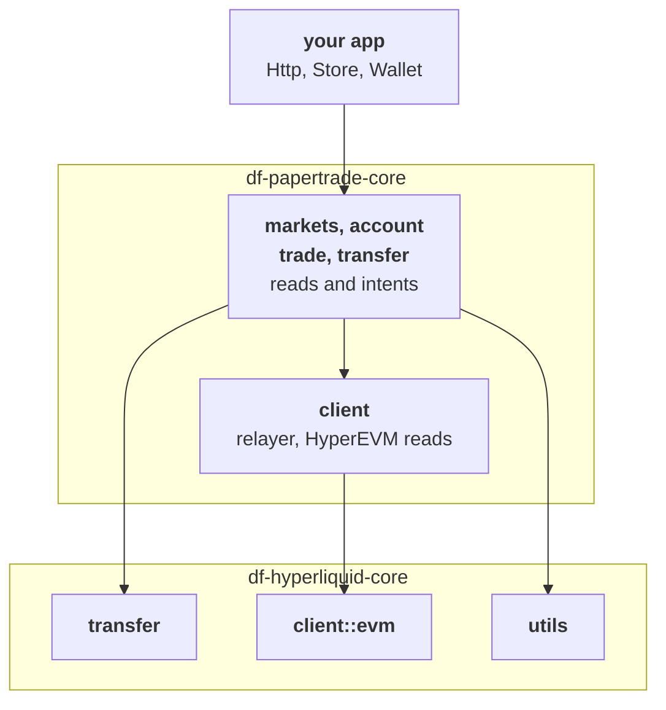

<p align="center">
  <a href="https://dfurrer.com">
    <picture>
      <source media="(prefers-color-scheme: dark)" srcset="assets/dfu-dark.svg">
      
    </picture>
  </a>
</p>

# df-papertrade-core

Rust SDK for [Papertrade](https://papertrade.xyz), gasless 1000x perps on HyperEVM: intents, relayer, live account and exact venue math, on df-hyperliquid-core.

## SDK

```text
df-papertrade-core
├── client        relayer, deployment, HyperEVM reads, Client
├── markets       trading state, protocol summary, payout queue, recent trades
├── account       live account, session keys, key and nonce storage, wallet
├── trade         intents and signatures, bust and PnL math, open, close, cancel
├── transfer      deposits from Hyperliquid
├── live          account stream parser
└── utils         units, intent nonces, JSON readers
```



## Examples

| Example | What it does |
|---|---|
| `cargo run -p df-papertrade-core --example papertrade_page` | Reads BTC's trading state and mid from mainnet, prints the unsigned open for a $10 long at 100x |

## Reference implementations

- [metalliq.xyz](https://metalliq.xyz)
- [tui.hip4.dev](https://tui.hip4.dev)

<br>

<p align="center">
  <sub><sub><a href="https://dfurrer.com">DFU</a></sub></sub>
  &emsp;&emsp;&emsp;
  <sub><a href="https://dfurrer.com">dfurrer.com</a></sub>
  &emsp;&emsp;&emsp;
  <sub><sub><a href="https://dfurrer.com">df.hl</a></sub></sub>
</p>
