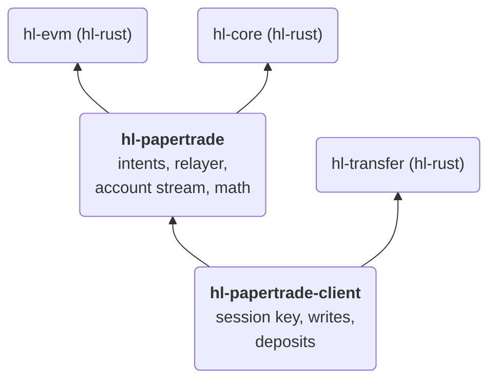

# papertrade-rust

Papertrade in Rust: [papertrade.xyz](https://papertrade.xyz), a perps venue on HyperEVM priced at Hyperliquid's BBO mid. Two crates on top of [hl-rust](https://github.com/dennisfurrer/hl-rust), the Hyperliquid family, which stays Hyperliquid only.



| Crate | Owns |
|---|---|
| `hl-papertrade` | Papertrade, a perps venue on HyperEVM priced at Hyperliquid's BBO mid (mainnet only, its contracts checked on chain): every intent a wallet or its session key signs (register a session key, open, close, withdraw to HyperCore, stake, unstake, claim, cancel) as EIP-712 under the venue's three domains, the wallet JSON, the payload the relayer takes and the intent id it answers with, against viem; session keys (30 days, status from the stream, signing in memory behind `sign`) and client-chosen nonces in two lanes; the relayer's calls as pure requests and a client over `Http` (never retried; the relayer refuses other origins, so a page proxies it); the trading state (23-field instrument rows, lifecycle checked), the live account stream (server-sent events split sans-IO, snapshot and patches folded with the app's checks); the protocol summary, markets, queue and recent trades; the venue's integer math as its app computes it (bust price, PnL through the deadband and impact curve and the win fee, open limits and refusals, the PAPER mint rate); deposit address, BBO, win fee and pending rewards read on chain |
| `hl-papertrade-client` | Papertrade for an app, so every frontend trades it as the venue's own app does: the reads over the caller's `Http` (trading state, summary, volumes, queue and its rank, recent trades, the BBO mid on chain, deposit address, pending rewards, win fee, the account stream's URL); the session key's life (32 bytes from the caller's randomness, kept in the caller's `Store` for 30 days in the 48-byte record the frontends already keep, registered once by the `Wallet` and posted once, renewed an hour before its end; `KeyState` from the record and the stream, the indexer given two minutes to list an accepted key); nonces in two lanes from a random start; open (checked first against the trading state read fresh and the account as last streamed), close (twelve ids to an intent), cancel, all signed by the session key; withdraw, stake, unstake and claim, signed by the wallet and recovered against the owner; each posted once and refused unless the relayer keeps it; deposits from Hyperliquid (the address registered with the sweeper and checked against the factory, the 1 USDC that opens a new HyperCore account, `usdClassTransfer` then `spotSend` from perps, `spotSend` from spot, `sendAsset` from a pooled account), each send signed by the wallet and posted to `/exchange` once. The wallet is handed what a confirm shows: the purpose, the typed-data JSON and its digest |

## Using it

Both repositories are private git dependencies. Name hl-rust at the same tag this workspace does (`Cargo.toml`), so cargo builds one `hl-core` for the app and for these crates:

```toml
hl-core = { git = "ssh://git@github.com/dennisfurrer/hl-rust.git", tag = "v0.1.0", default-features = false }
hl-papertrade = { git = "ssh://git@github.com/dennisfurrer/papertrade-rust.git", tag = "v0.1.0" }
hl-papertrade-client = { git = "ssh://git@github.com/dennisfurrer/papertrade-rust.git", tag = "v0.1.0" }
```

and fetch with git itself (`[net] git-fetch-with-cli = true`) so SSH keys apply. In CI each repository needs its own read-only deploy key; with `webfactory/ssh-agent`, give each key its repository as its comment (`ssh-keygen -C "git@github.com:dennisfurrer/papertrade-rust.git"`) so the right one is used for each fetch.

`cargo run -p hl-papertrade --example papertrade_page` reads BTC's trading state, the protocol's figures and the oracle's BBO from mainnet and prints the open a $10 long at 100x would post, without signing or sending anything.

## Rules

- **Layering:** `hl-papertrade` depends on `hl-core` and `hl-evm`; `hl-papertrade-client` on it and `hl-transfer`. Neither depends on hl-rust's umbrella or a wire.
- **Standalone:** no crate here depends on an app. Atlas and hip4-tui's papertrade connector are consumers, never dependencies.
- **Targets:** both crates build native and `wasm32-unknown-unknown`. The app brings the `Http`, the `Store` and the `Wallet`.
- **Signing:** `hl-papertrade` builds every intent's typed data, digest and payload without the curve; `sign` adds the session key held in memory and recovery. Every intent's typed data is checked against viem (`vectors/papertrade_viem.json`).

## The gate

`just check`: fmt, clippy native and wasm, every test, and the check that the protocol does not pull in the curve unless asked.
