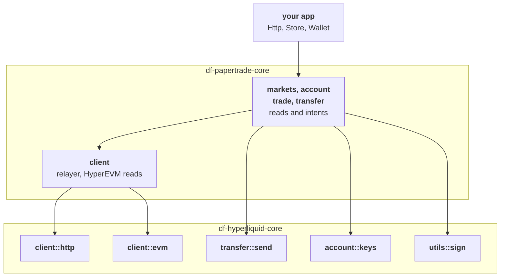

<p align="center">
  <a href="https://dfurrer.com">
    <picture>
      <source media="(prefers-color-scheme: dark)" srcset="https://dfu-cl-storybook.pages.dev/brand/markdfu-raised.svg">
      
    </picture>
  </a>
</p>

# df-papertrade-core

Rust SDK for [Papertrade](https://papertrade.xyz), gasless 1000x perps on HyperEVM: intents, relayer, live account and exact venue math, on df-hyperliquid-core. Follows contract set 2 (live since 2026-10-21), builder codes included.

## SDK

```text
df-papertrade-core
├── client          Client, config and reads, HyperEVM reads, deployment
│   └── relayer     requests as values, answers, the sender
├── markets
│   ├── trading     trading state, instruments, leverage bounds, the relayer's intake
│   └── stats       protocol summary, volumes, payout queue, recent trades, queue rank, builders
├── account         key and nonce storage, wallet
│   ├── state       live account from the stream
│   ├── session     stored session key, whether it signs, enable and register
│   └── session_key the key that signs opens, closes and cancels
├── trade
│   ├── intent      intents, EIP-712, signatures, intent ids
│   ├── math        bust prices, PnL after the payout curves, impact and fees, open limits, PAPER mint
│   └── writes      open, close, cancel, withdraw, stake, unstake, claim
├── transfer        deposits from Hyperliquid
├── live            account stream parser
└── utils           units, intent nonces, JSON readers
```



## Builder codes

A frontend the BuilderRegistry approves earns 0.5% of the PnL of winning closes made by session keys that name it. Set `Config::builder` to its address: each registration names it while the registry approves it, and none otherwise (the relayer refuses a registration that names an address it does not approve). `Client::builder_fees` and `Client::builder` read what it has earned; `chain::claim_builder_fees` is the transaction its own wallet sends to claim.

## Examples

| Example | What it does |
|---|---|
| `cargo run -p df-papertrade-core --example papertrade_page` | Reads BTC's trading state and mid from mainnet, prints the unsigned open for a $10 long at 100x |

## Tests

```text
packages/core
├── src/**/tests       unit: venue math, intents and EIP-712, the stream parser, account state, units
├── tests
│   ├── mocked         whole journeys through Client against a fake relayer, node and /exchange
│   └── live           mainnet, read only: every relayer read, the account stream, the HyperEVM views
└── fixtures           recorded relayer, stream and node answers
```

| Command | What it runs |
|---|---|
| `just check` | format, lint for native and wasm, unit and mocked, docs |
| `just live` | the live suite against mainnet, each answer held against its recording |
| `just cover` | line coverage of everything but the live suite |

## Reference implementations

- [metalliq.xyz](https://metalliq.xyz)
- [tui.hip4.dev](https://tui.hip4.dev)

<br>

<p align="center">
  <sub><sub><a href="https://dfurrer.com">DFU</a></sub></sub>
  &emsp;&emsp;&emsp;
  <sub><a href="https://dfurrer.com">dfurrer.com</a></sub>
  &emsp;&emsp;&emsp;
  <sub><sub><a href="https://dfurrer.com">df.hl</a></sub></sub>
</p>
